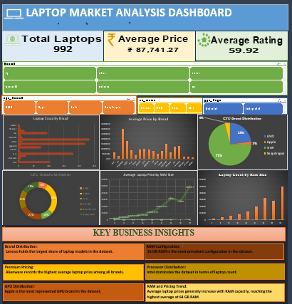

# Laptop Market Analysis Dashboard | Microsoft Excel

An interactive Excel dashboard for exploring laptop market data, analysing brand distribution, comparing pricing patterns, and identifying insights across hardware specifications.



---

## Table of Contents

- [Project Overview](#project-overview)
- [Business Objectives](#business-objectives)
- [Tools & Technologies](#tools--technologies)
- [Dashboard Features](#dashboard-features)
- [Key Business Insights](#key-business-insights)
- [Dataset Information](#dataset-information)
- [How to Use the Dashboard](#how-to-use-the-dashboard)
- [Skills Demonstrated](#skills-demonstrated)
- [Project Structure](#project-structure)
- [Conclusion](#conclusion)

---

## Project Overview

This project focuses on analysing laptop market data using Microsoft Excel. The dashboard transforms raw laptop specifications into meaningful business insights through data cleaning, PivotTables, PivotCharts, KPI cards, and interactive slicers.

The objective is to understand laptop distribution, pricing differences, hardware configurations, and market patterns through an interactive analytical dashboard.

## Business Objectives

- Identify brands with the highest representation in the dataset.
- Compare average laptop prices across brands.
- Analyse popular RAM configurations.
- Examine CPU and GPU brand distribution.
- Understand pricing patterns across different RAM capacities.
- Present findings through an interactive dashboard.

## Tools & Technologies

| Tool / Feature | Purpose |
|---|---|
| Microsoft Excel | Data analysis and dashboard development |
| PivotTables | Data summarisation and aggregation |
| PivotCharts | Visual representation of analytical findings |
| Slicers | Interactive filtering |
| Excel Formulas | KPI calculations |
| Data Cleaning | Handling missing and inconsistent values |

## Dashboard Features

- **3 KPI Cards:** High-level performance indicators.
- **6 Analytical Charts:** Brand, pricing, RAM, CPU, and GPU analysis.
- **4 Interactive Slicers:** Brand, CPU brand, GPU brand, and operating system.
- **Business Insights:** Key findings derived from the dataset.
- **Interactive Analysis:** Explore different segments using slicers.

## Key Business Insights

The analysis of 992 laptop records revealed the following findings:

| # | Area | Finding |
|---|---|---|
| 1 | **Brand Distribution** | Lenovo has the highest number of laptop models in the dataset. |
| 2 | **Premium Pricing** | Alienware records the highest average laptop price among the brands analysed. |
| 3 | **RAM Configuration** | 16 GB RAM is the most prevalent configuration. |
| 4 | **Processor Distribution** | Intel has the highest representation among CPU brands. |
| 5 | **GPU Distribution** | Apple is the most represented GPU brand in the dataset. |
| 6 | **RAM and Pricing Trend** | Average laptop prices generally increase with RAM capacity, reaching their highest level in the 64 GB category. |

> **Note:** These findings describe the analysed dataset and should not be interpreted as estimates of the entire laptop market.

## Dataset Information

- **Total Records:** 992 laptop entries.
- **Attributes:** Brand, model, price, RAM, CPU, GPU, operating system, and other laptop specifications.
- **Data Preparation:** Missing GPU brand values were labelled as "Not Specified" for consistent analysis.

## How to Use the Dashboard

1. Download or clone this repository.
2. Open `Laptop_Market_Analysis.xlsx` in Microsoft Excel.
3. Use the slicers (Brand, CPU Brand, GPU Brand, Operating System) to filter the data.
4. Watch the KPI cards and charts update to reflect your selection.
5. Clear the filters using the slicer's clear-filter icon to return to the full dataset view.

## Skills Demonstrated

- Data cleaning and preparation
- Exploratory data analysis (EDA)
- Data aggregation using PivotTables
- Interactive dashboard development
- Data visualization
- Business insight generation
- Analytical storytelling

## Project Structure

```text
Laptop-Market-Analysis/
│
├── Laptop_Market_Analysis.xlsx
├── dashboard.png
└── README.md
```

## Conclusion

This project demonstrates how Microsoft Excel can be used to transform structured data into interactive dashboards and actionable analytical insights.

It strengthened my practical understanding of data analysis, visualization, and business-oriented reporting.

---

**Future Scope:** Expanding the dataset with more recent models, adding performance benchmarks, and building a similar dashboard in Power BI or Python.

**Author:** Your Name | [LinkedIn](www.linkedin.com/in/astha-kumari-4753b83b0) | [GitHub](https://github.com/asthakumari-data)
